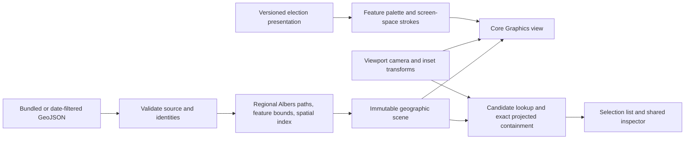

# Albers rendering architecture

## Source, projection and scene

- `GeoJSON` validates the original geometry. `HistoricalArchive` still selects inclusive civil dates with versioned IDs and byte-preserving extracts. The state and county stores remain separate. The same-source key is a bundled URL for immutable app resources and the extracted SHA-256 for a temporal snapshot. Arbitrary Imports continue to use MapLibre in this lab.
- `AlbersProjection` maps real WGS 84 coordinates to regional meters. `AlbersScene` flips northing for the screen, then translates each panel at the same scale. `InsetLayout` lets tests or another presentation choose inset order and metric separation. A scene retains ordered immutable paths, feature attributes and regional bounds. Tap conversion ends in regional projected meters. A future geographic camera center or cursor readout would justify adding a validated inverse.
- Each panel has one flat bounding-volume hierarchy. Median splits use the longest node axis and leaves hold at most 12 part indices. Visible and selectable candidates are returned in paint order. When a viewport covers the panel, its full array is reused as the search domain. Separate feature bounds make fit-to-feature independent of geographic part count. Core Graphics performs the last containment test with the same even–odd rule as fill, and the UI shows a choice if more than one geographic identity contains a tap.
- For modern validated bundled geometry, decoding, validation and projection happen off main using one decoded collection. The path cache owns at most two entries and a combined cap of 700,000 source positions. Position count is a sizing proxy. The currently displayed scene has a separate reference. The cache drops on renderer exit, backgrounding and memory warnings. A snapshot's temporary file is retained only by its dataset and any in-flight preparation.

## Camera, styling and interaction

- UIKit owns viewport center and magnification. Fit uses the scene, regional panel or selected feature bounds. Panning, pinch and double tap transform the existing paths with a 1×–16× bound. The camera uses one surface for national and focused inset navigation. Programmatic transitions interpolate center and scale for approximately 280 ms and use immediate framing with Reduce Motion. Refitting to a new geographic source and preserving a camera across same-source election years are separate behaviors.
- The results adapter maps stable geographic IDs to paint and inspector rows from the existing election presentation. Candidate colors retain historical party families, and the alternate palette also updates the textual results legend. A county margin scale uses the validated reported leader–runner-up margin over reported totals. Unresolved, tied, no-data and nonparticipating treatments remain distinguishable by text. Symbolic stripes describe allocations across a jurisdiction.
- Election presentations retain at most the two most recently used year/mode values. The active national and county package identifiers are checked before reuse. Eviction is independent of projected-scene eviction. Styling, border width and selection redraw with the same paths. Clearing or changing a selection leaves the geographic identity intact until a source or result revision changes.
- Request cancellation checks guard both asynchronous preparation and publication. The active source, year, presentation and inspection change together on the main actor. A result switch cannot apply to an obsolete geographic source. Changing source dismisses old geographic search results. All selection paths use the shared inspector, including the searchable list and overlapping-boundary chooser.

The existing `UIView` is the evaluated backend. A second backend could consume the same regional meter geometry, ordered stable IDs, style rules and camera constraints. Before introducing tessellated buffers, record whether low-zoom stalls come from application drawing, scheduling or composition on a real device. Geometry needs no new general-purpose framework to make that determination.
