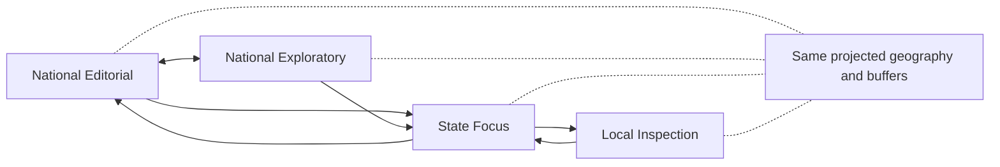

# GeoKit cartographic presentation

| Policy | Framing and eligibility | Native presentation |
| --- | --- | --- |
| National Editorial | National framing, stable interior candidates, designated external annotations, ranked text variants | The lab uses this by default for Albers electoral maps. DistrictAtlas uses restrained optional detail labels. |
| National Exploratory | National starting frame, pan, zoom, regional and viewport eligibility, progressive readable detail | Both consumers share the geography, search and ordered picking. The lab retains the 0.4B exploratory resolver behavior for comparison. |
| State Focus | Fit the actual projected bounds of a caller-specified group. Submit and hit-test eligible features only. | County and district detail use thin boundaries, a quiet context layer and optional labels. |
| Local Inspection | Fit a selected feature. Retain group eligibility if reached from State Focus. | The consumer keeps the feature identity and displays the appropriate inspection details. |



`CartographicPolicy` is presentation intent. `CartographicPresentation` resolves it against a projected scene and a caller-supplied group key. Regional camera transforms, a padded aspect-preserving fit, dense feature membership and path-based picking come from the active scene. Compositions share the canonical projection identity. The consumer retains its election, style, inspection and source provenance. Changing the active dataset can retire the old mesh through the existing generation gate.

```swift
let intent = CartographicPolicy.stateFocus(group: "01")
let focus = CartographicPresentation(policy: intent, scene: scene, groupKey: "STATEFP")
surface.setVisibleFeatures(focus?.visibleFeatures)
if let focus { surface.move(camera: focus.camera(in: viewport), selected: selected) }
```

The CPU mesh representation stays at 0.4B. GPU preparation derives a small CPU table of triangle ranges from the existing indexed triangles. A visibility change coalesces contiguous fill ranges and reuses the original ring segment ranges. National draws retain the original triangle batches and deduplicated edges. Focus draws read original edges to preserve a shared boundary when the adjacent county is hidden. The shader distinguishes ordinary original-edge strokes from selected strokes through the existing camera pass field. The shader functions, pipeline count, vertex and index ABI, and GPU buffers otherwise follow 0.4B. Source publication installs the mask for the new revision explicitly; preparation and completion safeguards stay in place. [Mesh regression](GEOKIT_0.4C_REGRESSION_REPORT.md)

`GeographicContextLayer` is a separately projected decorative scene. The Apple adapter uses the active mainland panel transform and the camera's geographic rectangle to cull and draw state outlines with Core Graphics. Both renderers use this same context contract. The consumer supplies provenance, color and stroke width. Context contributes no hit targets to the county or district scene. Alaska and Hawaii remain isolated from mainland context.

The geographic camera uses the viewport from `GeographicMapLayout`. The national editorial key occupies a dedicated 24-point region. The lab's compact-height controls preserve room above it. AppKit owns native window sizing. UIKit and AppKit retain compatible text measurement contracts. Anchor, typography, external decision and inspector responsibilities remain distinct.

`--cartography-debug` shows candidate centers, accepted text rectangles, a containment envelope, suppression notes, viewport and focus frame. Context strokes remain visible in focus. `--cartography-metrics` records context drawing for dedicated measurements. Ordinary navigation runs omit both flags. Preparation and policy events remain available in the lab's opt-in JSONL diagnostics.
