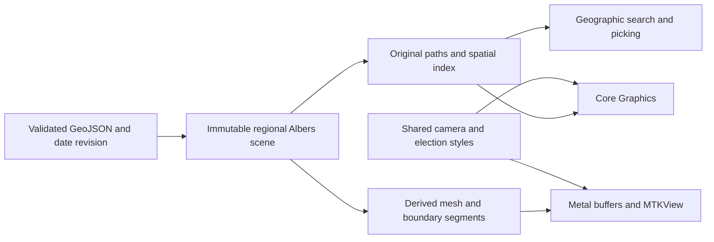

# Albers Metal renderer architecture

The standalone lab offers **Albers Core Graphics**, **Albers Metal** and **MapLibre** in the Map view menu. Core Graphics remains the default for election Albers. The Metal launch option is `--albers-metal`.

The shared scene determines feature order, regional membership, panel translations and geographic hit tests. Its densified paths provide contours and even–odd semantics to the mesh adapter. Polygon parts of the same feature share a style and a stable source identity. The canvas applies the existing pan, pinch, double-tap, rotation, focus and Reduce Motion behavior. The Metal child supplies the pixels. The existing SwiftUI geography search, overlap list, inspector, outcome text and legends supply the accessible interaction.

## Mesh contract

The backend-neutral Swift structs store a regional Double origin, ordered part and feature associations, separate triangle and boundary data, and selection ranges. Panel translations follow the existing equal-scale inset layout. The Metal vertex shader subtracts the local camera center and applies one scale and viewport conversion. Panel geometry stays stable across camera and style updates.

| Buffer | Layout | Purpose |
| --- | --- | --- |
| Triangle vertex | Float32 x/y, UInt32 part, UInt32 padding. 16 bytes. | Regional meters after Double origin subtraction. |
| Triangle index | UInt32. 4 bytes. | One indexed triangle batch per visible panel. |
| Part | UInt32 feature, Float32 stripe origin. 8 bytes. | Identifies style and gives stripes a stable phase within the part. |
| Original segment | Two Float32 x/y positions, UInt32 part, UInt32 padding. 24 bytes. | Geographic rings and per-feature selection. |
| Unique segment indices | UInt32. 4 bytes. | The original stroke draw references one instance per exact segment. |
| Feature style and palette | UInt32 offset/count. 8 bytes per feature. RGBA Float32. 16 bytes per color. | Replaces only style data when the election or theme changes. |

The depth value comes from the projected part order. Later parts are closer, so overlapping polygons draw in the same order as in Core Graphics. Interior holes retain their original even–odd coverage. The fill shader also handles the geometry-only selection fill and the optional symbolic five-point stripe pattern. The same election presentation supplies candidate and party colors, margin buckets, tied results, unresolved or missing results and nonparticipating styles. Stripe placement encodes allocations symbolically. It uses state boundaries when the selected election draws a state split.

## Boundaries and antialiasing

A stroke starts from a densified ring edge, including edges of holes. Six instanced vertices form a screen-space quad and sample interpolation evaluates a round-ended capsule. The union of adjacent capsules forms round joins. Normal geographic strokes use 0.48 points, or 1.2 points when emphasized. A separate 1.5-point amber-brown outline redraws the selected part's rings in the foreground. The normal boundary color is opaque so adjacent capsules and shared edges do not multiply opacity. Exact coincident segment endpoints share one instance, with the uppermost incident part's depth. The shader submits only ring segments, so tessellation diagonals cannot enter the boundary pass.

The tested full-quality setting uses 4× MSAA for fills, borders and depth. Metal resolves the multisample color attachment into the native drawable. Single-sample and fill-only switches are comparative research configurations. The inset frame uses simple rectangular decoration drawn by Metal and a UIKit label. Core Graphics retains its rounded inset frames and translucent strokes, so the two systems have minor pixel-level styling differences.

## Ownership and failure paths

A background task builds and uploads buffers for one geographic revision. Cancellation is checked across parts and before upload. The canvas checks the revision again before showing the result. Styles use immutable feature and color buffers. The view owns the active buffer set. Committed commands retain their own references. A three-command, nonblocking gate limits GPU work in flight. An idle map draws on invalidation, and backgrounding stops new submissions. Any material mesh or device error moves the request to Core Graphics and exposes its reason. [MTKView](https://developer.apple.com/documentation/metalkit/mtkview) · [Metal drawable lifecycle](https://developer.apple.com/documentation/metal/mtldrawable).

Panel culling is coarse. A visible mainland panel submits its entire buffer at every scale. Frame encoding, bounds sampling and GPU execution are tracked separately. Runtime MSL compilation avoids a separate build tool dependency and contributes a synchronous first-use cost. The shader and draw adapter are the platform-specific layers. The underlying geometry, projection, camera, feature IDs, hit testing and presentation stay shared.
